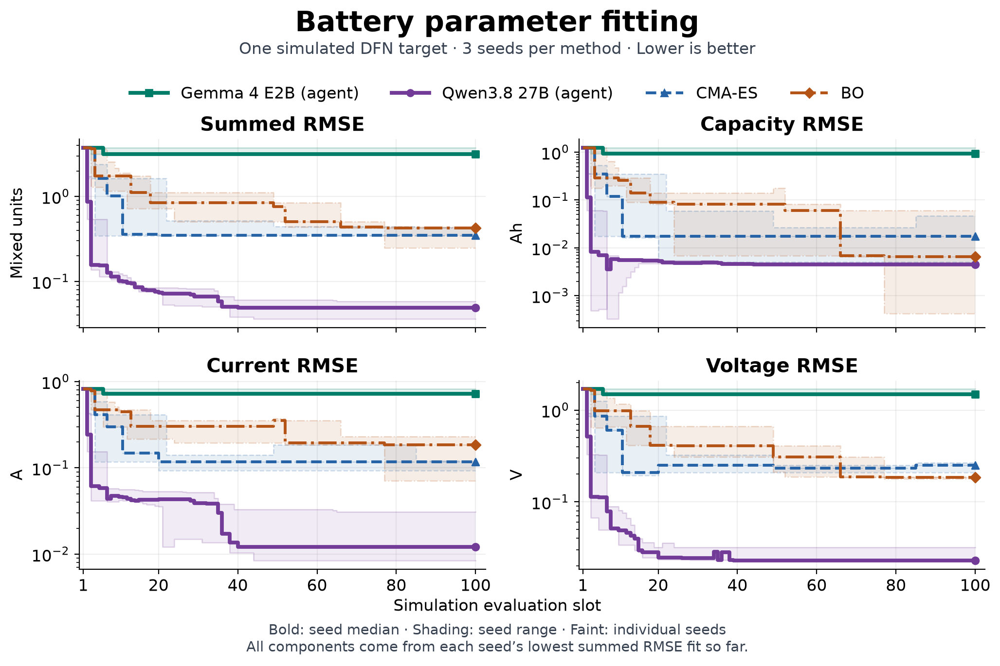

# Agentic Batt

Agent-versus-baseline experiments for battery parameter fitting, plus an OPAL neural-network optimization pilot.

## Battery fitting at 100 evaluations per seed

**Qwen3.8 27B had the lowest mean RMSE for capacity, current, and voltage. Gemma 4 E2B trailed both baselines.** All four methods fit one simulated DFN / Chen2020 target with the same initial parameters, summed RMSE objective, and 100 simulation slots per seed. The 1,200 slots include 50 solver failures.



At each slot, all four panels use each run's lowest summed-RMSE fit so far. Lines show the median across seeds. Individual terms can rise when a new fit improves the sum.

| Method | Capacity RMSE (Ah) | Current RMSE (A) | Voltage RMSE (V) | Summed RMSE | Best summed MAPE (%) |
| --- | ---: | ---: | ---: | ---: | ---: |
| Qwen3.8 27B | **0.00460** | **0.01712** | **0.02585** | **0.04757** | **0.7076** |
| Gemma 4 E2B | 1.04483 | 0.75438 | 1.55540 | 3.35461 | 63.5987 |
| CMA-ES | 0.02299 | 0.11006 | 0.24121 | 0.37427 | 3.9079 |
| Bayesian optimization | 0.02260 | 0.16294 | 0.18302 | 0.36856 | 7.5642 |

Values are means across three seeds at 100 slots. All RMSE columns use the same fit per seed. Summed MAPE selects its own best fit. [Summed RMSE and MAPE curves](plots/battery_matched.png) · [Per-seed results and parameters](experiments/battery/matched/results/summary.json)

**What the agents changed.** The agents use physics hints, per-channel errors, and charge/discharge timing. The baselines receive scalar loss. Qwen proposed thinning the negative electrode to reduce excess capacity (5.06 vs. 3.81 Ah) and adjusted particle radii and porosity. Its best fit in each seed used 64 µm, down from 85.2 µm. Gemma mostly repeated candidates, testing 1–4 distinct parameter sets per seed. [Qwen proposal trace](experiments/battery/matched/results/qwen_seed0/trajectory.jsonl#L2)

[Protocol and BO recovery](docs/matched_benchmark.md) · [Campaign provenance](experiments/battery/matched/results/campaign_manifest.json) · [Earlier Gemma pilot with different budgets and objectives](plots/battery_all_methods.png)

## OPAL agent versus AdamW

A separate MNIST experiment: the agent edits optimizer code during training. Same seed, minibatch order, five epochs, and 2,340 updates; test evaluation happens after training without agent access to test metrics.

| Run | Test accuracy | Training wall time |
| --- | ---: | ---: |
| Plain AdamW | 98.45% | 2.42s |
| OPAL keep control | 98.45% | 2.55s |
| Gemma agent | 98.45% | 12.83s |
| Qwen3.8-27B agent | **98.58%** | 920.62s |


Qwen applied one cosine learning-rate restart at update 1,200, preserving AdamW state. One earlier proposal failed adapter checks. The **0.13 percentage-point gain is from one seed**; test cross entropy was slightly higher. The plain, keep, and Gemma controls produced identical weights.

[OPAL results](experiments/opal/results/summary.json) · [Applied updater](experiments/opal/programs/v001/updater.py) · [Decisions](experiments/opal/results/qwen/decisions.json)

## Reproduce

[Setup and experiment commands](docs/reproduction.md) cover the pinned upstream code, local Ollama models, and isolated run directories. JSON/CSV records and PNG/SVG plots are committed; model weights, datasets, and environments are excluded.

```sh
python3.11 scripts/verify_results.py
python3.11 scripts/summarize_matched.py --data experiments/battery/matched/results
# With requirements-plots.txt installed:
python3.11 scripts/plot_matched.py \
  --summary experiments/battery/matched/results/summary.json \
  --channels --out plots/battery_matched_channels
python3.11 scripts/plot_results.py
```

The [overhead projection](plots/agent_overhead_projection.png) illustrates amortizing a fixed agent budget over longer training; it is not a distributed benchmark.

Built on [Battery-Sim-Agent](https://github.com/opqrst-chen/Battery-Sim-Agent) and [OPAL](https://github.com/xingjian-bai/opal), with pinned revisions in their provenance records. [MIT license](LICENSE) · [Third-party notices](THIRD_PARTY_NOTICES.md).
