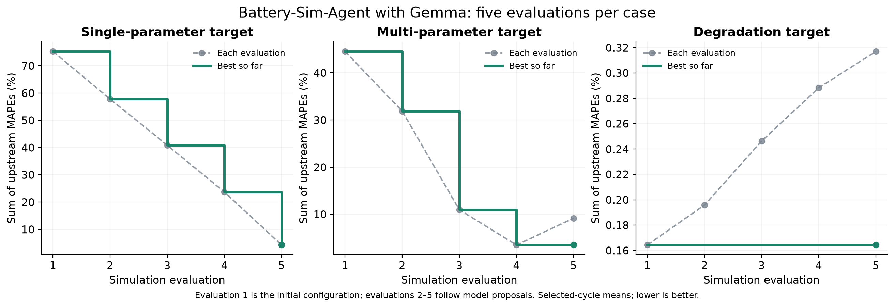
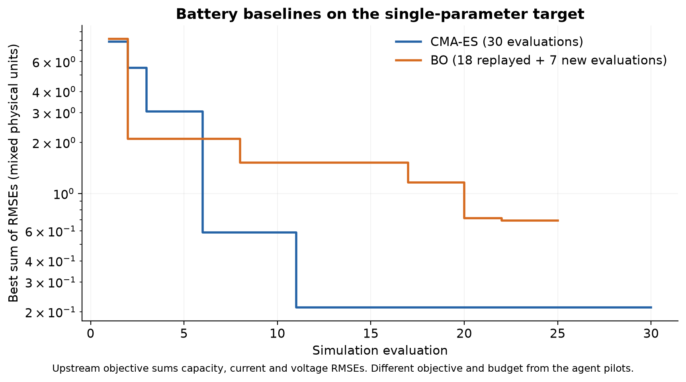
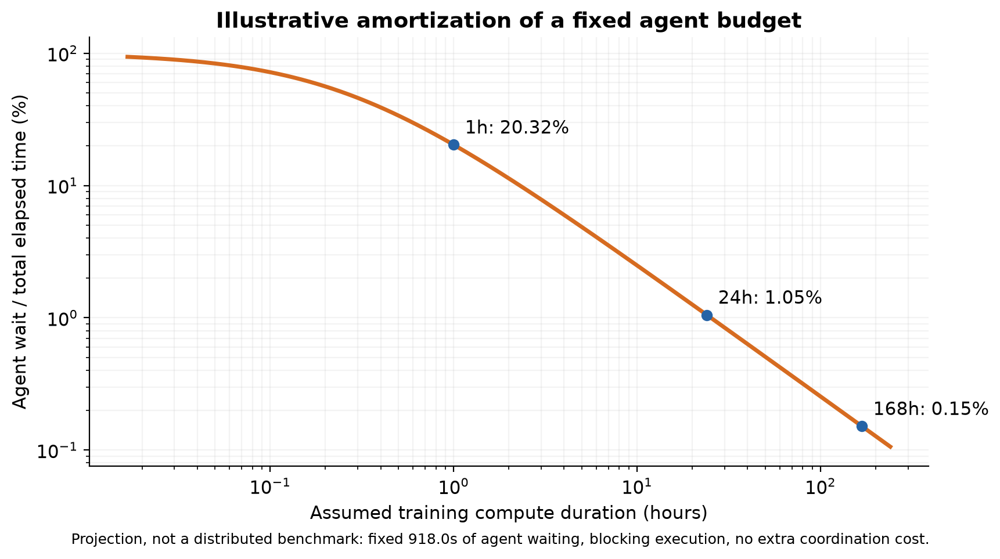

# Agentic Batt

Local experiments in agent-guided battery simulation and neural-network optimization, collected by [EvergreenTree](https://github.com/EvergreenTree). The battery pilots improved two parameter-fitting cases but did not improve the degradation case. In a separate OPAL pilot, Qwen changed a learning-rate schedule and increased MNIST test accuracy from **98.45% to 98.58%** in one seed.

These are two distinct tasks: **Battery-Sim-Agent proposes physical parameters for a fixed simulator; OPAL proposes optimizer code during neural-network training.** The OPAL result is on MNIST, not battery data. Measurements were collected on October 24–26, 2026; this repository packages those existing runs.

## Battery simulation results

The three Gemma pilots each used five valid simulation evaluations: one initial configuration and four model proposals. The simulator was PyBaMM 25.6.0 with a DFN model and Chen2020 parameters. The score below sums the upstream capacity, current, and voltage MAPEs, averaged over the selected cycles; lower is better.

| Target case | Initial score | Best score | Best evaluation | Elapsed time |
| --- | ---: | ---: | ---: | ---: |
| Single parameter, test 2 | 75.2348 | 4.2847 | 5 | 61.0s |
| Multiple parameters, test 4 | 44.5453 | 3.5068 | 4 | 36.6s |
| Degradation, test 0 | 0.164354 | 0.164354 | 1, initial | 48.0s |



The model was `gemma4:e2b-qat-google`. Single and multiple refer to the target perturbation; the agent could adjust nine parameters in either first-cycle case. The multi-parameter case's final proposal was worse than its best proposal; the degradation proposals all worsened the aggregate score. The published trajectories retain every evaluation, not only improvements.

The classical baselines used the single-parameter target and minimized the upstream sum of capacity, current, and voltage **RMSEs**, which mixes physical units. CMA-ES completed 30 evaluations with a best objective of **0.212384**. Bayesian optimization completed 25 evaluations with a best objective of **0.693016**; 18 evaluations were replayed with parameter-match checks and seven were new model-based evaluations. Different objectives and budgets prevent a controlled agent-versus-baseline ranking.



[Battery summary](experiments/battery/results/summary.json) · [Agent trajectory](experiments/battery/results/agent/trajectory.csv) · [Baseline trajectory](experiments/battery/results/baselines/trajectory.csv)

## OPAL optimizer results

MNIST MLP, 784–512–512–10 with ReLU; 60,000 training examples, five epochs, batch size 128, 2,340 updates, seed 0, CPU with four training threads. The starting optimizer was AdamW with learning rate 0.001, weight decay 0.01, and cosine decay to zero. All runs used the same minibatch order. Test accuracy was measured on 10,000 held-out examples in a separate process after training, without test feedback to the agent.

| Run | Test accuracy | Test cross entropy | Training wall time | Applied changes |
| --- | ---: | ---: | ---: | ---: |
| Plain AdamW | 98.45% | 0.051186 | 2.42s | — |
| OPAL keep control | 98.45% | 0.051186 | 2.55s | 0 |
| Gemma agent | 98.45% | 0.051186 | 12.83s | 0 |
| Qwen3.8-27B agent | **98.58%** | 0.051233 | 920.62s | 1 |


Qwen used Q4_K_M weights, medium reasoning, temperature 1.0, a 32,768-token context, and an 8,192-token generation cap. At update 600, the adapter rejected its proposal for unsupported Python constructs. At update 1,200, a repaired proposal restarted cosine learning-rate decay from 0.001 to zero over the remaining training, preserving AdamW moments and step counters. At update 1,800, Qwen kept that updater. Betas, epsilon, weight decay, and diagnostics remained unchanged.

The observed gain is **0.13 percentage points**, or 13 additional correct test predictions. Test cross entropy was slightly higher. This single-seed pilot does not establish a reliable improvement across seeds or transfer to larger training jobs. Plain, keep, and Gemma losses and final parameter hashes are identical; Qwen's first 1,200 recorded losses match the plain run.

[OPAL summary](experiments/opal/results/summary.json) · [Qwen decisions](experiments/opal/results/qwen/decisions.json) · [Applied updater](experiments/opal/programs/v001/updater.py) · [Other attempts](experiments/opal/results/other_attempts.json)

## Agent overhead at larger scale

Qwen's pilot spent 917.96 seconds waiting for the agent. If that same total decision budget were used during 24 hours of training compute, blocking agent overhead would be approximately **1.05% of total elapsed time**. This is an arithmetic projection, not a distributed-training measurement. Decision frequency, synchronization, and changes to per-step compute still matter.



The relevant next experiment measures time and GPU-hours to a target quality across matched seeds, including inference and training pauses. A compute-bound job alone does not guarantee either a quality gain or a cost saving.

## Reproduce and inspect

The committed result records and plots can be inspected without models or simulation datasets. Original local experiment directories were preserved. Upstream projects are referenced at fixed commits; trained checkpoints, model weights, datasets, environments, caches, and raw model reasoning are excluded.

Regenerate all four figures as PNG and SVG using Python 3.11:

```sh
python3.11 -m venv .venv-plots
.venv-plots/bin/python -m pip install -r requirements-plots.txt
.venv-plots/bin/python scripts/plot_results.py
python3.11 scripts/verify_results.py
```

For setup, model aliases, and experiment commands, see [Reproduction](docs/reproduction.md). Reruns create fresh output directories and do not overwrite the committed results. Model-generated proposals and timings may vary across machines and inference versions.

## Sources and layout

| Directory | Contents |
| --- | --- |
| `experiments/battery/` | Battery measurements, parameters, compatibility patch, and portable runners |
| `experiments/opal/` | MNIST measurements, optimizer versions, local Ollama adapter, and portable runners |
| `plots/` | Observed result figures and separately labeled overhead projection, PNG and SVG |
| `scripts/` | Plot regeneration and result consistency checks |
| `docs/` | Reproduction commands and interpretation |

- [Battery-Sim-Agent](https://github.com/opqrst-chen/Battery-Sim-Agent), revision `354f2ddcbb8d14d6dfe9673aac55199976d2d42c`.
- [OPAL](https://github.com/xingjian-bai/opal), revision `8b16759a3e9930916ed582e28068267859f935f8`.

MIT-licensed upstream notices are retained in each experiment directory. See [third-party notices](THIRD_PARTY_NOTICES.md) and the [license](LICENSE).
