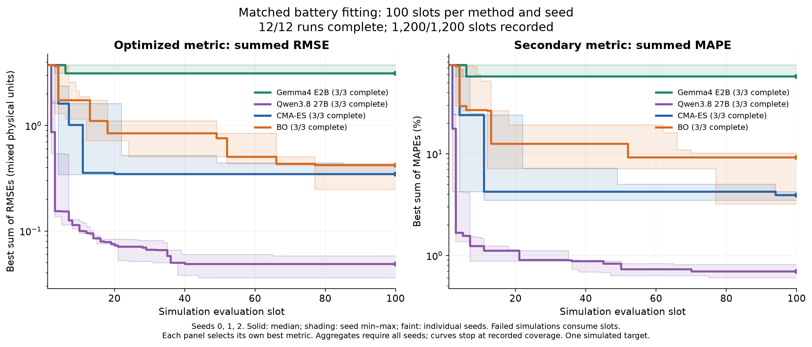

# Agentic Batt

Agent-versus-baseline experiments for battery parameter fitting, plus an OPAL neural-network optimization pilot.

## Battery: matched 100-evaluation comparison

Gemma, Qwen, CMA-ES, and BO fit the **same simulated DFN / Chen2020 target**, starting from the same parameters and optimizing the same summed RMSE. Each method receives **100 simulation slots per seed, seeds 0–2**; failed simulations consume slots.



| Method | Completed seeds | Best summed RMSE | Best summed MAPE (%) |
| --- | ---: | ---: | ---: |
| Gemma4 E2B | 3/3 | 3.3546 ± 0.3606 | 63.5987 ± 10.0772 |
| Qwen3.8 27B | 3/3 | **0.0476 ± 0.0111** | **0.7076 ± 0.1081** |
| CMA-ES | 3/3 | 0.3743 ± 0.0508 | 3.9079 ± 0.3848 |
| BO | 3/3 | 0.3686 ± 0.1040 | 7.5642 ± 3.7980 |

Values are mean ± sample standard deviation of each seed's best observed score. Each metric selects its own candidate; RMSE sums mix physical units. The plot shows medians and seed ranges. **Qwen achieved lower fitting error than both CMA-ES and BO across these three seeds; Gemma mostly plateaued.** This is one simulated target, not the paper's multi-chemistry 58–97% MAPE claim.

Agents receive physics hints and curve diagnostics; the classical baselines receive scalar loss. The match is in target, starting point, objective, and simulation budget.

All **12 runs and 1,200 slots are complete**: 1,150 valid simulations and 50 numerical solver failures (29 CMA-ES, 21 BO). The original GPU job completed the nine agent/CMA runs, but BO failed at initialization because it loaded an incompatible Torch native library. The repaired launcher passed actual-container checks; all three BO seeds then completed on CPU with the same scientific code and target. Their provenance and timings remain separate, so this is an evaluation-budget comparison rather than an equal-hardware timing comparison.

[Protocol and recovery details](docs/matched_benchmark.md) · [Results and selected parameters](experiments/battery/matched/results/summary.json) · [Campaign provenance](experiments/battery/matched/results/campaign_manifest.json)

The [earlier five-evaluation Gemma pilot](plots/battery_all_methods.png) reached summed RMSE 0.3598; CMA-ES reached 0.2124 in 30 evaluations. Those runs used different budgets, feedback, and native objectives. The matched runs are fresh experiments, not extensions of those trajectories. [Archived pilot records](experiments/battery/results/summary.json).

## OPAL agent versus AdamW

A separate MNIST experiment: the agent edits optimizer code during training. Same seed, minibatch order, five epochs, and 2,340 updates; test evaluation happens after training without agent access to test metrics.

| Run | Test accuracy | Training wall time |
| --- | ---: | ---: |
| Plain AdamW | 98.45% | 2.42s |
| OPAL keep control | 98.45% | 2.55s |
| Gemma agent | 98.45% | 12.83s |
| Qwen3.8-27B agent | **98.58%** | 920.62s |


Qwen applied one cosine learning-rate restart at update 1,200, preserving AdamW state. One earlier proposal failed adapter checks. The **0.13 percentage-point gain is from one seed**; test cross entropy was slightly higher. The plain, keep, and Gemma controls produced identical weights.

[OPAL results](experiments/opal/results/summary.json) · [Applied updater](experiments/opal/programs/v001/updater.py) · [Decisions](experiments/opal/results/qwen/decisions.json)

## Reproduce

[Setup and experiment commands](docs/reproduction.md) cover the pinned upstream code, local Ollama models, and isolated run directories. JSON/CSV records and PNG/SVG plots are committed; model weights, datasets, and environments are excluded.

```sh
python3.11 scripts/verify_results.py
python3.11 scripts/summarize_matched.py --data experiments/battery/matched/results
# With requirements-plots.txt installed:
python3.11 scripts/plot_matched.py \
  --summary experiments/battery/matched/results/summary.json --out plots/battery_matched
python3.11 scripts/plot_results.py
```

The [overhead projection](plots/agent_overhead_projection.png) illustrates amortizing a fixed agent budget over longer training; it is not a distributed benchmark.

Built on [Battery-Sim-Agent](https://github.com/opqrst-chen/Battery-Sim-Agent) and [OPAL](https://github.com/xingjian-bai/opal), with pinned revisions in their provenance records. [MIT license](LICENSE) · [Third-party notices](THIRD_PARTY_NOTICES.md).
