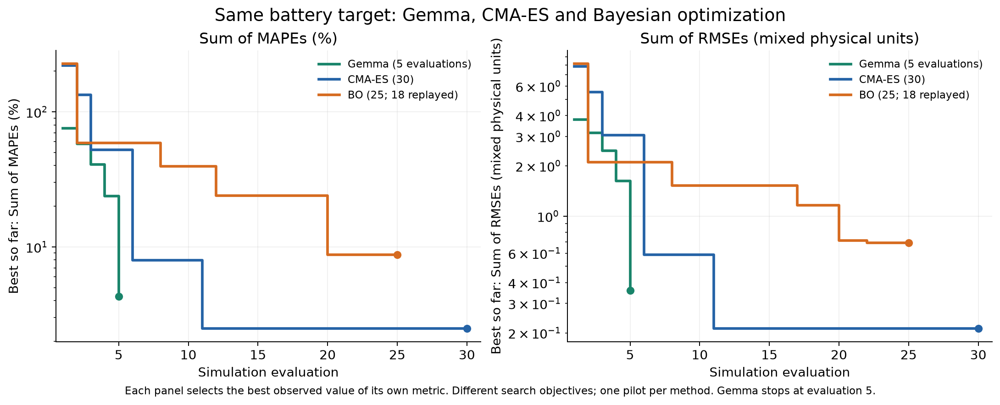
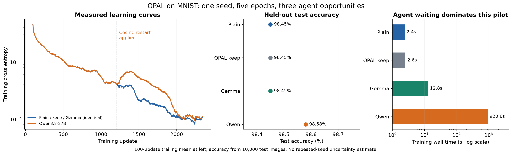

# Agentic Batt

Agent-versus-baseline experiments for battery parameter fitting, plus an OPAL neural-network optimization pilot. Results below come from the recorded October 24–26, 2026 runs.

A new [matched-budget battery campaign](docs/matched_benchmark.md) compares Gemma, Qwen, CMA-ES, and BO at **100 evaluations × three seeds per method** on one cloud GPU. Its [deployment status](experiments/battery/matched/launch_status.json) is separate from the pilot results below. This single-target study does not establish the paper's reported 58–97% MAPE reduction.

## Battery agent versus baselines

Gemma, CMA-ES, and Bayesian optimization fit the **same simulated battery target** (test 2, PyBaMM DFN / Chen2020). Both panels report common metrics computed from every method’s recorded candidates; lower is better.



| Method | Evaluations | Best sum of MAPEs (%) | Best sum of RMSEs |
| --- | ---: | ---: | ---: |
| Gemma agent | 5 | 4.2847 | 0.3598 |
| CMA-ES | 30 | **2.4894** | **0.2124** |
| Bayesian optimization | 25 | 8.7494 | 0.6930 |

Each column selects its own best observed candidate; RMSEs sum mixed physical units. **Gemma reached a low error in five evaluations; CMA-ES achieved the lowest final errors with a larger budget.** Gemma’s curve ends at five—there are no later measurements.

This is a descriptive pilot comparison: budgets, initialization, and feedback differ. Gemma receives physics hints and structured diagnostics; the classical baselines optimize summed RMSE. CMA-ES uses populations of six; BO begins with 18 Sobol evaluations (replayed with parameter checks here), followed by seven model-based evaluations. A controlled ranking needs matched budgets and repeated runs.

[Comparison data](experiments/battery/results/agent_vs_baselines.json) · [Full battery results](experiments/battery/results/summary.json) · [All three Gemma cases](plots/battery_agent_convergence.png)

The other Gemma pilots improved the multi-parameter target but not degradation. Single/multi describes the target perturbation; both first-cycle searches allow nine adjustable parameters.

## OPAL agent versus AdamW

A separate MNIST experiment: the agent edits optimizer code during training. Same seed, minibatch order, five epochs, and 2,340 updates; test evaluation happens after training without agent access to test metrics.

| Run | Test accuracy | Training wall time |
| --- | ---: | ---: |
| Plain AdamW | 98.45% | 2.42s |
| OPAL keep control | 98.45% | 2.55s |
| Gemma agent | 98.45% | 12.83s |
| Qwen3.8-27B agent | **98.58%** | 920.62s |



Qwen applied one cosine learning-rate restart at update 1,200, preserving AdamW state. One earlier proposal failed adapter checks. The **0.13 percentage-point gain is from one seed**; test cross entropy was slightly higher. The plain, keep, and Gemma controls produced identical weights.

[OPAL results](experiments/opal/results/summary.json) · [Applied updater](experiments/opal/programs/v001/updater.py) · [Decisions](experiments/opal/results/qwen/decisions.json)

## Reproduce

[Setup and experiment commands](docs/reproduction.md) cover the pinned upstream code, local Ollama models, and isolated run directories. JSON/CSV records and PNG/SVG plots are committed; model weights, datasets, and environments are excluded.

```sh
python3.11 scripts/verify_results.py
# With requirements-plots.txt installed:
python3.11 scripts/plot_results.py
```

The [overhead projection](plots/agent_overhead_projection.png) illustrates amortizing a fixed agent budget over longer training; it is not a distributed benchmark.

Built on [Battery-Sim-Agent](https://github.com/opqrst-chen/Battery-Sim-Agent) and [OPAL](https://github.com/xingjian-bai/opal), with pinned revisions in their provenance records. [MIT license](LICENSE) · [Third-party notices](THIRD_PARTY_NOTICES.md).
